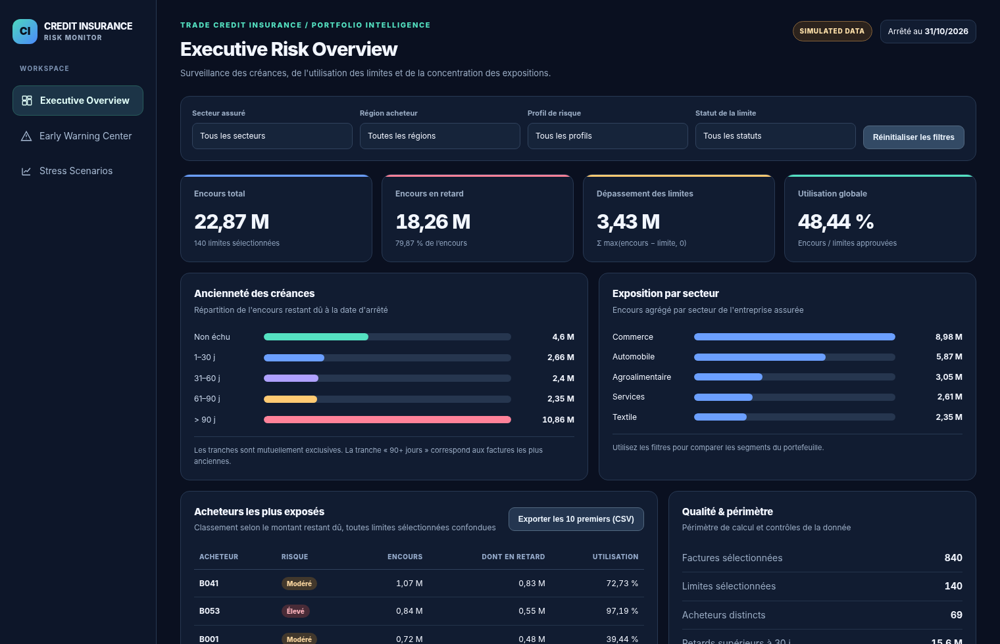
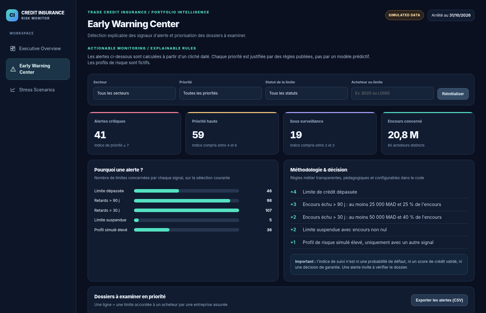
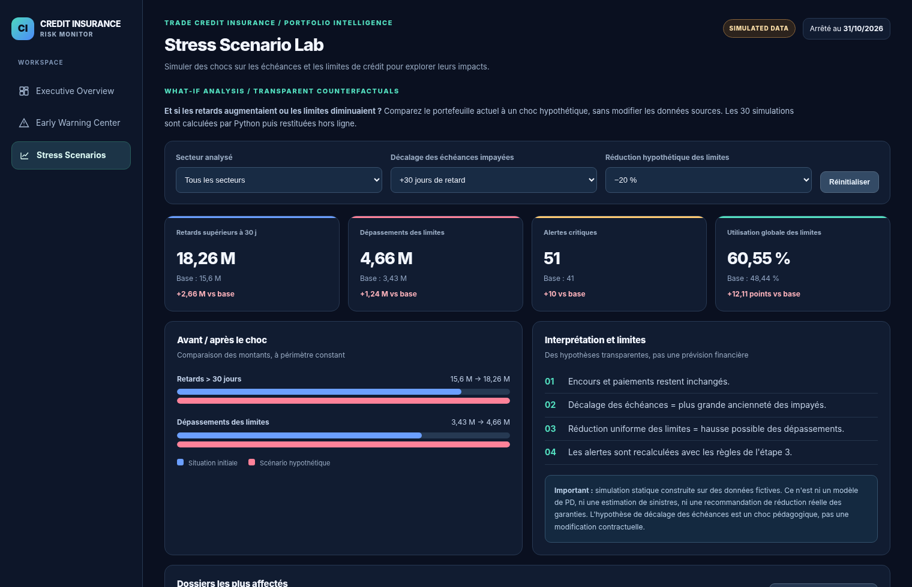

# Credit Insurance Risk Monitor

**Trade Credit Insurance • Explainable Early Warning • Portfolio Analytics • Stress Testing**



> **100% synthetic Moroccan-style B2B data.** Academic portfolio project: no real client records, no validated credit scoring, no automated underwriting or insurance decision.


### Try the interactive demo

🚀 [Explore the Live Interactive Dashboard](https://nkhawla000-cmyk.github.io/credit-insurance-risk-monitor/) Explore three interactive modules to monitor credit insurance exposures, identify explainable warning signals, and simulate stress scenarios using synthetic data.

The dashboard operates **offline**, with all scenario data prepared in Python. It has three sections:
| Portfolio overview | Explainable alerts | Stress scenario laboratory |
|---|---|---|
|  |  |  |

### Business value

Trade credit insurance monitors **insured suppliers** and their **buyer debtors**. This demonstrator identifies exposed buyers, overdue receivables, credit-limit breaches and explainable warning signals, then simulates what-if changes under transparent rules.

**Why it is more than a dashboard:** dated payment events make historical exposure calculations reproducible; data-quality controls quarantine invalid records; the buyer and insured-supplier roles are modeled separately; priority scores have readable rule-based explanations; scenario impacts are computed in Python, not fabricated or inferred.

### Verified demonstration snapshot — 31 October 2026

| Metric | Synthetic result |
|---|---:|
| Insured suppliers | 8 |
| Buyers | 80 |
| Credit-limit relationships | 140 |
| Valid invoices | 840 |
| Outstanding receivables | 22.87 million MAD |
| Overdue receivables | 18.26 million MAD |
| Credit-limit excess | 3.43 million MAD |
| Synthetic-data quality rejections | 4 |

The high overdue share reflects a **deliberately stressed synthetic demonstration scenario**, not a market statistic.

### Architecture

```text
synthetic CSVs ──> Python ETL + quality checks ──> SQLite + as-of snapshots
                                                     ├──> KPI & alerts (Python)
                                                     ├──> stress grid (30 scenarios)
                                                     ├──> offline HTML dashboard
                                                     └──> Power BI CSV export + DAX guide
```

### Reproduce locally (Python 3.10+, **standard library only**)

```bash
python3 -m src.generate
python3 run.py --as-of 2026-10-31
python3 export_powerbi.py
python3 build_dashboard.py
python3 -m unittest discover -s tests -v
open dashboard/index.html           # macOS, or double-click dashboard/index.html
```

**Power BI:** `powerbi/datasets/portfolio_flat.csv` is a convenient 140-row one-table dataset suitable for browser-based Power BI. Reconciled dimensional/fact datasets, scenario tables and example DAX measures are also supplied. **No .pbix file is claimed.** See [Power BI setup](docs/POWER_BI_FR.md).

### Repository layout

- `src/generate.py`, `src/etl.py`, `src/metrics.py`: synthetic data and dated exposure calculations.
- `src/alerts.py`: human-readable alert rules and priority.
- `src/stress.py`: 30 what-if scenarios, 5 aging shifts × 6 limit reductions.
- `src/bi_export.py`: reusable BI CSV exports with reconciliation checks.
- `dashboard/`: responsive, self-contained dashboard. Public demo can be hosted on GitHub Pages.
- `tests/`: quality, reconciliation, business logic, dashboard and scenario tests.
- `assets/`: verified screenshots of simulated interactive views.
- `docs/`: modeling notes and step-by-step French guides.

### Interpret with care

- Every company ID, invoice and payment is fake. The model is educational.
- Risk bands are simulated labels and the priority index is an **explainable heuristic**, *not* a PD estimate or bank credit score.
- The scenario model shifts invoice ages and changes limits, not contract terms, cash flow or default probability.
- Approved-limit totals should **not** be interpreted as insured coverage, indemnities or claims.
- Current limitation: limit values and suspension statuses do not have their own historical event log.

### Guides

[Business & technical architecture](docs/ARCHITECTURE.md) · [BI / Power BI on Mac](docs/POWER_BI_FR.md) · [GitHub publishing (FR)](docs/GITHUB_PUBLICATION_FR.md) · [Stage 4 assumptions](docs/ETAPE_4_FR.md)

### Technology

`Python` · `SQLite` · `SQL` · `HTML` · `CSS` · `JavaScript` · `DAX (prepared)` · `unittest` · `GitHub Actions`

**License:** to be decided before third-party redistribution. Public viewing does not imply open-source licensing.
